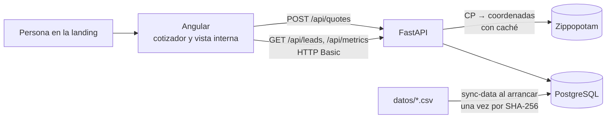
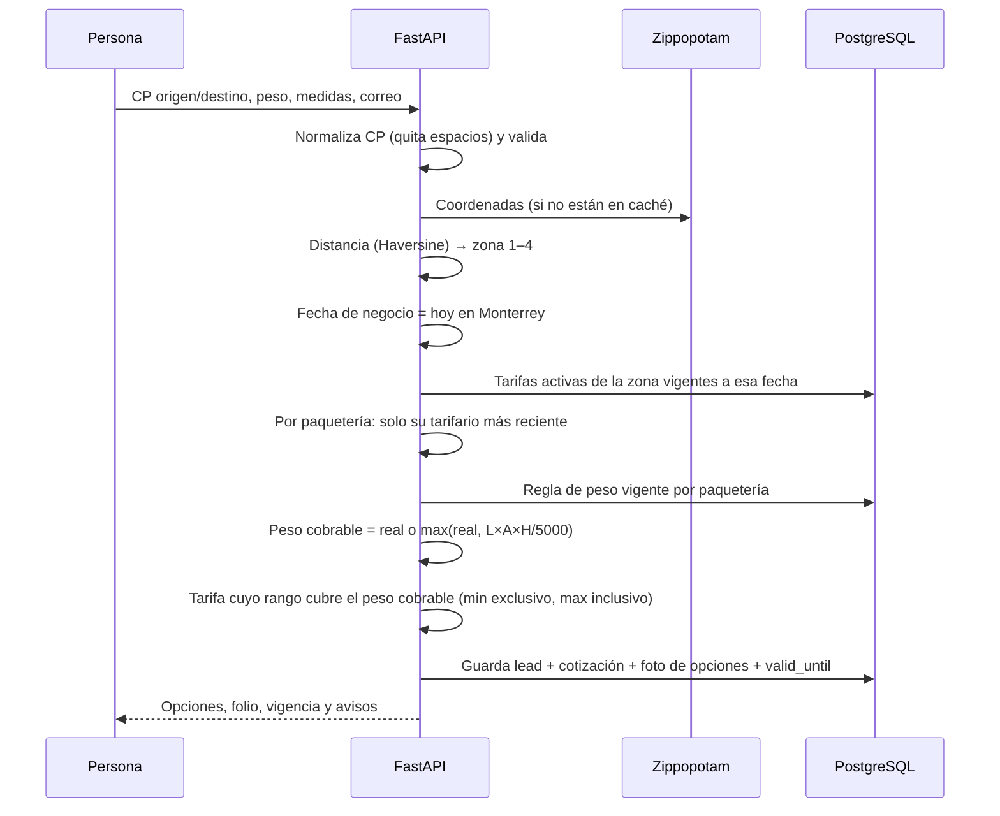
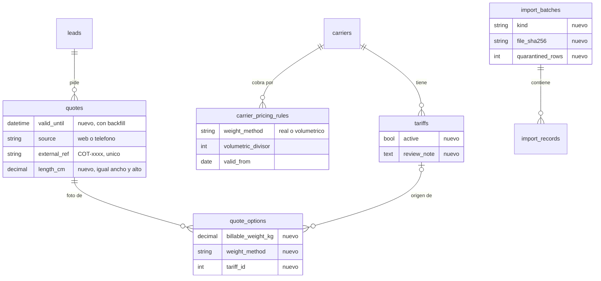

# Fase 2: guía para exponer la solución

Documento de apoyo para la entrevista de revisión: qué se hizo, por qué, cómo funciona y cómo demostrarlo. Los datos de prueba están en [`PRUEBAS_MANUALES.md`](PRUEBAS_MANUALES.md) y el detalle de cada decisión en [`../DECISIONES.md`](../DECISIONES.md) (sección 5).

---

## 1. Resumen en 30 segundos

> El cotizador ya estaba en producción. Había que cambiar tarifas y reglas de cobro sin romper lo que ya se había cotizado. Separé **datos** de **código**: tarifas y reglas de peso viven en la base de datos, versionadas por fecha, y se cargan desde archivos. Cada cotización guarda una **foto inmutable** del precio que vio la persona, válida 30 días. Al investigar a Customer Care encontré tres bugs reales (la pantalla se quedaba en "Consultando...", el CP con espacios fallaba y las paqueterías salían duplicadas en pesos exactos) y tres precios mal capturados que se estaban cotizando en producción, uno de ellos en $217,672.

## 2. Qué pidió cada área y qué se entregó

| Quién | Pidió | Entregado |
|---|---|---|
| Comercial | Tarifas DHL nuevas desde el 1 de diciembre | `tarifas_dhl_v2.csv` cargado; entra solo a las 00:00 de Monterrey |
| Comercial | DHL y FedEx por peso volumétrico; Estafeta después | Reglas por paquetería y fecha en `reglas_peso.csv`; Estafeta se cambia con una línea |
| Comercial | Respetar cotizaciones 30 días | Foto del precio + `valid_until`; folio visible; vista interna dice si sigue garantizado |
| Comercial | Registrar 40 cotizaciones telefónicas | Importadas como `source='telefono'`, idempotentes por `cotizacion_id` |
| Todos | Que el próximo cambio no requiera código | Sincronización de `datos/` por hash al arrancar |
| Customer Care | CP con espacios, ciudad, "vecino ve otra" | Investigado: 3 bugs corregidos y 1 comportamiento normal explicado ([informe](INVESTIGACION_CUSTOMER_CARE.md)) |
| Growth | Cotizaciones por día y sin opciones | `GET /api/metrics/quotes` + tarjetas y tabla en la vista interna |
| Equipo | Fase 1 intacta | Migración con backfill, sin tocar precios guardados; probada desde `v1` |

## 3. Arquitectura

Arranque del backend: `alembic upgrade head` → `python -m app.cli sync-data` → `uvicorn`.

| Pieza | Archivo |
|---|---|
| Reglas de tiempo (Monterrey, 30 días, fecha simulada) | `backend/app/core/clock.py` |
| Motor de precios | `backend/app/services/pricing.py` |
| Sincronización de `datos/` | `backend/app/importers/sync.py` |
| Importadores | `importers/tariffs.py`, `pricing_rules.py`, `historical_quotes.py` |
| Endpoint de cotización | `backend/app/api/quotes.py` |
| Métricas | `backend/app/api/metrics.py` |
| Migración de fase 2 | `backend/alembic/versions/b7d1c0a2e901_...py` |

## 4. Cómo se calcula una cotización

## 5. Decisiones clave (y por qué)

### 5.1 Tarifas y reglas son datos versionados, no código
Cada tarifa tiene `vigencia_desde`. Cada paquetería tiene reglas de peso con fecha (`carrier_pricing_rules`). El código solo pregunta "¿qué aplica en esta fecha?". Por eso el 1 de diciembre no hay despliegue: el cambio ya está cargado y se activa solo.

### 5.2 Un tarifario nuevo reemplaza completo al anterior
DHL v1 tenía un rango **3–6 kg** en zona 2 que v2 ya no trae. Si solo cerráramos rangos idénticos, desde diciembre un paquete de 5.5 kg mostraría DHL dos veces (3–6 viejo y 5–10 nuevo). La regla es: por paquetería, se usa solo su lote con la vigencia más reciente ya iniciada. **Supuesto** (en `PREGUNTAS.md`): cada archivo es el tarifario completo de esa paquetería.

### 5.3 Límite de rango `min < peso ≤ max`
En fase 1 era `min ≤ peso ≤ max`: con 1 kg exacto caían 0–1 y 1–3, y la misma paquetería salía dos veces con precios distintos. No lo decidí por gusto: **lo deduje de los datos**. En las cotizaciones de Comercial, COT-0026 (DHL, zona 3, 1 kg) cobra el precio de 0–1.

### 5.4 Volumétrico
`peso volumétrico = largo × ancho × alto / 5000`, redondeado hacia arriba al gramo para no cobrar de menos. Se cobra el mayor entre real y volumétrico. Las medidas son obligatorias en el formulario y opcionales en el API, para no romper integraciones de fase 1. Si faltan y la paquetería cobra por volumétrico, **no se cotiza esa paquetería** y se explica por qué: no inventamos el tamaño de la caja.

### 5.5 Foto inmutable + 30 días
`quote_options` guarda precio, plazo, peso cobrable, método y la tarifa de origen. Nada se recalcula. `valid_until` = fin del día 30 en hora de Monterrey; la migración lo calcula para las cotizaciones de fase 1 a partir de su fecha. Así "se le cobra lo que vio en pantalla" queda garantizado por diseño, no por disciplina.

### 5.6 Hora de Monterrey, no del servidor
El contenedor corre en UTC. Con `date.today()`, el 30 de noviembre a las 18:00 (hora de Monterrey) ya sería 1 de diciembre y se cotizaría con tarifas nuevas 6 horas antes. Todo pasa por `clock.py` con `America/Monterrey`.

### 5.7 Cuarentena en vez de "corregir"
Comercial pidió "no inventen tarifas". Tres precios tenían el punto decimal corrido. No los corregí: los marqué `active=false` con su motivo (más de 5× fuera de la mediana de su rango). Se reactivan cuando Comercial confirme. Evidencia: COT-0012 cotizó $2,176.72 donde la tabla decía $217,672.00.

### 5.8 Carga idempotente por contenido
Cada CSV se importa una vez por su SHA-256. Reiniciar no duplica nada. El lote de fase 1, que no tenía hash, se reconoce por nombre. El próximo cambio de tarifas consiste en dejar el archivo en `datos/` y reiniciar.

## 6. Modelo de datos: qué cambió

Una sola migración (`b7d1c0a2e901`), con `downgrade` probado: upgrade → downgrade → upgrade sobre una base que venía de `v1`.

## 7. Hallazgos de la investigación

1. **"06600 " no da resultado: bug.** `maxlength="5"` cortaba " 06600" a " 0660" antes de limpiar, y el 422 de v1 era una lista técnica que el frontend no sabía mostrar.
2. **"Se traba": bug, que venía de v1.** El frontend es Angular 21 sin `zone.js` (zoneless). La respuesta HTTP llegaba (201) pero la pantalla no se refrescaba y se quedaba en "Consultando...". Se corrigió con `markForCheck()` tras cada respuesta, en el cotizador y en la vista interna.
3. **"Se traba con la ciudad": UX.** El campo borraba letras en silencio. Ahora avisa qué escribir.
4. **"Mi vecino ve otra paquetería": normal.** Depende de origen, peso y medidas, y hay huecos de tarifas (75 de 108 filas rechazadas en fase 1). Además existía el bug del límite de rango (5.3).
5. **Datos:** 3 precios con el punto decimal corrido que se cotizaban en producción (5.7).

## 8. Calidad

- **Backend: 111 pruebas** (69 en `v1`), con SQLite en memoria y sin red. Incluyen una carga completa de los CSV reales.
- **Frontend: 30 pruebas** (eran 22): CP pegado, aviso de ciudad, medidas, folio, vigencia, refresco sin `zone.js` y la leyenda de volumétrico.
- Migración probada contra PostgreSQL 16 partiendo del esquema de `v1`, con una cotización de fase 1 cuyo precio no cambió.

## 9. Qué no hice y qué recomiendo

| Tema | Por qué no | Siguiente paso |
|---|---|---|
| Búsqueda por ciudad o colonia | Zippopotam no busca por nombre | Catálogo SEPOMEX propio |
| Subir CSV desde la vista interna | Fuera de alcance; hoy es dejar el archivo y reiniciar | Endpoint de carga con vista previa del reporte |
| Redondeo comercial del volumétrico (kilo / medio kilo) | No lo especificaron | Pregunta 10 en `PREGUNTAS.md` |
| Completar 75 tarifas rechazadas | Son datos de Comercial | Lista con motivo en `import_records` |
| Autenticación de producción | HTTP Basic es solo para evaluación | SSO o tokens + HTTPS |

## 10. Preguntas probables y respuesta corta

**¿Qué pasa si DHL manda otro tarifario en febrero?**
Se deja `tarifas_dhl_2027.csv` con su `vigencia_desde` en `datos/` y se reinicia. Desde esa fecha reemplaza al actual; las cotizaciones ya emitidas no cambian.

**¿Y cuando Estafeta pase a volumétrico?**
Una línea en `reglas_peso.csv`: `Estafeta,volumetrico,5000,AAAA-MM-DD`.

**¿Cómo garantizas que una cotización vieja no cambia de precio?**
No se recalcula nunca: `quote_options` es una copia del precio, no una referencia a la tarifa. `tariff_id` existe solo para trazabilidad.

**¿Por qué no actualizas `valid_to` de las tarifas viejas, como en el commit anterior?**
Esa lógica sigue ahí para rangos idénticos, pero no basta: el rango 3–6 de DHL quedaría vivo. Resolver "tarifario más reciente por paquetería" al consultar no depende del orden en que se carguen los archivos.

**¿Por qué 5× para la cuarentena?**
Los errores reales se alejaban entre ~90× y ~200× (punto decimal corrido); las diferencias legítimas entre paqueterías y zonas son de menos de 3×. 5× separa ambos casos con margen y exige al menos 3 referencias para no marcar nada a ciegas.

**¿Por qué las medidas son opcionales en el API?**
Para no romper a un cliente de fase 1. Sin medidas, las paqueterías volumétricas no se cotizan y la respuesta lo explica en `notices`.

**¿Por qué las telefónicas no cuentan en las métricas?**
Growth pregunta por uso del cotizador; esas no pasaron por él. Está en `PREGUNTAS.md` por si quieren lo contrario: es un filtro de una línea.

**¿Cómo pruebas el 1 de diciembre hoy?**
Con `FECHA_SIMULADA` (solo demo; `/health` la muestra si está activa). En las pruebas automatizadas se congela el reloj.

**¿Por qué la pantalla se quedaba en "Consultando..."?**
Angular 21 genera proyectos sin `zone.js`. Sin zone.js, Angular no se entera de que llegó una respuesta HTTP si el estado vive en propiedades normales. Se resolvió llamando a `markForCheck()` al terminar cada petición. La alternativa más idiomática es mover el estado a *signals*. La prueba que lo cubre no fuerza el refresco a mano: falla sin la corrección.

**¿Qué riesgo ves?**
Que el supuesto "archivo = tarifario completo" no se cumpla: si Comercial manda un archivo parcial, esa paquetería perdería rangos. Por eso está como pregunta abierta y el reporte de carga muestra exactamente qué entró.

## 11. Guion de demo (5 minutos)

1. **Log de arranque** (30 s): cuatro archivos importados, 3 en cuarentena; reiniciar → "sin cambios".
2. **Customer Care** (1 min): pegar ` 06600 `, escribir "Monterrey", 1 kg zona 4 sin duplicados.
3. **Cuarentena** (30 s): 15 kg zona 4 → sin opciones (antes $217,672).
4. **1 de diciembre** (1.5 min): activar `FECHA_SIMULADA`; 2 kg en caja 40×30×30 zona 4 → FedEx y DHL cobran 7.2 kg, Estafeta 2 kg.
5. **Precio respetado** (1 min): vista interna → buscar `cliente21` → $381.26 garantizado hasta el 06/12, aunque hoy DHL cotiza $415.57.
6. **Growth** (30 s): tarjetas y tabla diaria; las telefónicas no cuentan.
